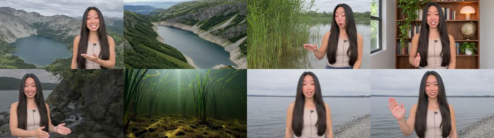
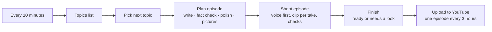
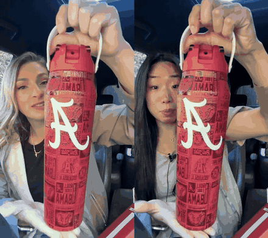
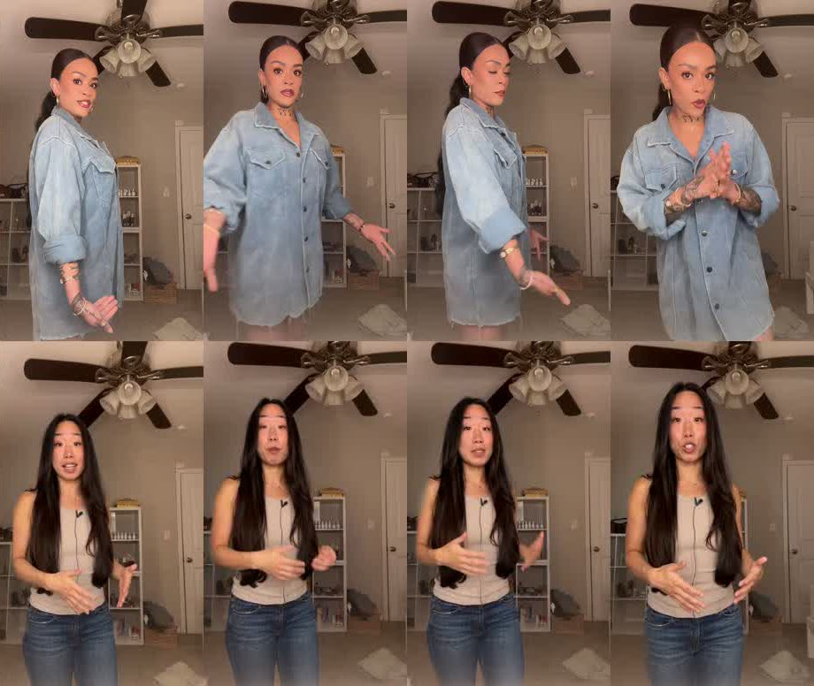
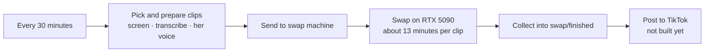
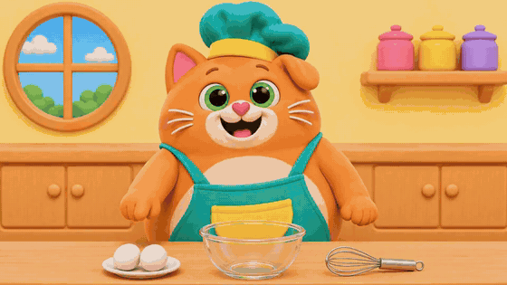
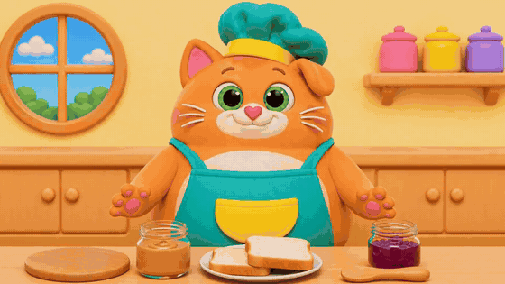
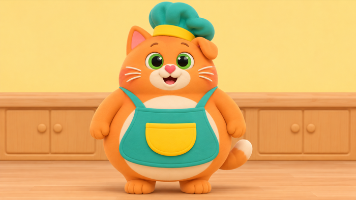
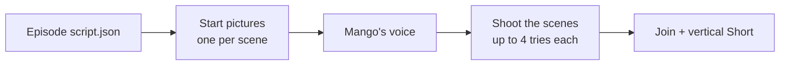

# n8n video pipelines

Three video pipelines that run on their own, orchestrated by [n8n](https://n8n.io) on a Mac and rendered on rented RTX 5090s (Vast.ai, ComfyUI, MiniMax H3 / HyperFlow Flash):

| Pipeline | What it makes | Workflow |
|---|---|---|
| **Educational presenter** | An AI presenter explains one science question per episode, as a wide video and a vertical Short, and publishes both to YouTube | [`workflows/episode-machine.json`](workflows/episode-machine.json) |
| **Person swap** | Takes an existing product video, replaces the person with our presenter and gives her one consistent voice | [`workflows/swap-machine.json`](workflows/swap-machine.json) |
| **Kids cartoon** | "Mango", a round orange cat, teaches children to cook one simple recipe per episode | [`workflows/cartoon-machine.json`](workflows/cartoon-machine.json) |

Every step is a small Python script that prints one line of JSON, so n8n decides what happens next and a failed step never kills a run.

---

## 1. Educational presenter

<p>
  
</p>



**Examples**

- [Where Lakes Come From, wide](examples/educational/where_lakes_come_from_wide.mp4) · on YouTube: [full video](https://youtu.be/BaN0UU_2_w4), [Short](https://youtube.com/shorts/u0HyGbN97EM)
- [Where Autumn Colors Come From, Short](examples/educational/autumn_colors_short.mp4) · on YouTube: [full video](https://youtu.be/z2u2fQGekaU)
- More on YouTube: [Why the Ocean Is Salty](https://youtu.be/Pu-ULSf8eaY), [How Bees Turn Nectar Into Honey](https://youtu.be/RsnuOvQ8PkI), [How Ice Carves a Valley](https://youtu.be/hPCfV74w4_I)

**How it works**



1. **Plan** ([`scripts/plan_episode.py`](scripts/plan_episode.py)). Claude writes the script from the director rulebook ([`skills/episode-director/SKILL.md`](skills/episode-director/SKILL.md)), a second pass checks every fact, a third rewrites any line that reads badly out loud. Then one start picture per place is generated from the presenter's master picture, and each picture is checked for the right face and for body mistakes.
2. **Shoot** ([`scripts/make_episode.py`](scripts/make_episode.py)). The voice comes first: Fish Audio speaks the line, and the video model generates the clip around that audio so the mouth follows the voice. Each clip is then checked three ways:
   - **words**: the clip is transcribed and compared with the script (pass at 0.97),
   - **face**: it must still be her (`scripts/face_check.py`),
   - **big mistakes**: a vision model looks at six frames for swapped limbs, oversized hands, a changed outfit or background, a second person, text on screen (`scripts/clip_check.py`).

   A take gets up to four tries. Small things, such as a bracelet that comes and goes, are deliberately ignored.
3. **Finish and publish** ([`scripts/episode_job.py`](scripts/episode_job.py)). Clean episodes go on the publish list, flagged ones wait for a person to listen. Publishing is spaced so a new channel is not flooded.

The complete rule set the machine follows is in [`docs/RULEBOOK.md`](docs/RULEBOOK.md).

---

## 2. Person swap

Original creator on the left, our presenter on the right. Same room, same product, same movements, her face and her voice.

<p>
  
</p>
<p>
  
</p>



**Examples**

- [Side by side 1](examples/swap/side_by_side_1.mp4): first trial, original soundtrack
- [Side by side 2](examples/swap/side_by_side_2_bottle_buddy.mp4): with her own voice
- [Side by side 3](examples/swap/side_by_side_3_retro_console.mp4): from an unattended overnight batch

The creators in these clips are members of the Kaiyros creator program and agreed to this feature.

**How it works**



1. **Pick** ([`swap/prep_swaps.py`](swap/prep_swaps.py)). Each candidate video is screened by a vision model on six frames. It is kept only if there is exactly one person, the face is visible and talking, a product is held or shown, it is not an outfit video, and there are no word-by-word captions. [`swap/text_screen.py`](swap/text_screen.py) then drops clips with text on screen for more than a few seconds and starts the rest after the opening caption.
2. **Her voice**. The clip is transcribed, and Fish Audio speaks each sentence in the presenter's voice at the moment the creator said it. That track replaces the soundtrack before the swap, so the model lip-syncs her to her own voice.
3. **Swap** ([`swap/box/run_swap.py`](swap/box/run_swap.py), [`swap/box/queue.sh`](swap/box/queue.sh)). Runs on a second GPU with the OpenJutsu one-click swap workflow (MiniMax H3 ref2va + SAM 3.1 + Qwen3-VL). The queue script swaps every uploaded clip, one at a time.
4. **Collect**. Finished videos land in `swap/finished/` with a small JSON file holding creator, product and words. No text is added; captions are done by hand afterwards.

**What it is good and bad at.** Strong on close-up, product-in-hand clips. Weak on outfit videos (she keeps her own clothes), burned-in captions (they get garbled) and full-body turns.

The video list comes from a private Kaiyros API client that is not part of this repository. To use the swap pipeline elsewhere, replace the `DISCOVER` call in `swap/prep_swaps.py` with your own source of video URLs.

---

## 3. Kids cartoon: Mango the cat

<p>
  
</p>
<p>
  
</p>



**Examples**

- [Mango makes an omelet](examples/cartoon/mango_omelet.mp4) (43 s, five shots)
- [Mango makes a PB&J sandwich](examples/cartoon/mango_pbj.mp4) (50 s, six shots)
- [Mango makes a fruit and yoghurt cup](examples/cartoon/mango_fruit_cup.mp4) (first test)

Frame sheets: [omelet](docs/media/cartoon_omelet_frames.jpg), [PB&J](docs/media/cartoon_pbj_frames.jpg).

**How it works**



An episode is one `script.json` with an entry per scene: what Mango **says**, what the start **picture** shows, and what Mango **does**. See [`cartoon/omelet/script.json`](cartoon/omelet/script.json).

What keeps it consistent:

- One fixed character description ([`cartoon/character.txt`](cartoon/character.txt)) and one art style ([`cartoon/style.txt`](cartoon/style.txt)) go into every prompt.
- Every start picture is made from the previous one, so the cat, the kitchen and the props stay identical.
- Everything a scene uses must already be visible in its start picture, and the action is described as something that is *seen happening* ("the egg is seen falling from the shell into the bowl"). This is what stopped ingredients from appearing out of nowhere.
- Kid-safe by rule: no knives, no flame, and the hot pan is always "a job for a grown-up".

The full account of what was tried is in [`cartoon/REPORT.md`](cartoon/REPORT.md).

> The three example episodes were made by running the scripts in `cartoon/` step by step. `cartoon/cartoon_job.py` and `workflows/cartoon-machine.json` chain those same steps for n8n; the workflow imports cleanly but has not yet produced an episode end to end without a person.

---

## Repository layout

```
workflows/            the three n8n workflows (import these)
scripts/              educational pipeline steps and checks
skills/               the director rulebook Claude writes episodes from
her/                  the presenter's master picture and stock studio sets
swap/                 person-swap picker, sender, collector
swap/box/             files that run ON the swap GPU (install, queue, swap)
cartoon/              Mango: character, style, episode scripts, steps
poster/               YouTube publisher (browser automation helpers)
comfyui-mcp/          the ComfyUI driver the scripts import, plus the video workflows
docs/                 RULEBOOK.md, RUNBOOK.md, pictures for this page
examples/             finished example videos
set_5090.py           point the Mac at a GPU (reads the link from the clipboard, never prints the token)
setup_5090.sh         install models and nodes on the episode GPU
start.sh, status.sh   start n8n, one-command health report
```

## Setup in short

Full steps are in [`docs/RUNBOOK.md`](docs/RUNBOOK.md).

1. **GPU.** Rent an RTX 5090 on Vast.ai with the ComfyUI template (100 GB disk for episodes and cartoon, 200 GB for the swap machine). Run `setup_5090.sh` in its terminal, or `swap/box/install.sh` on the swap machine.
2. **Driver.** Copy `comfyui-mcp/` to `~/comfyui-mcp/`. Copy the machine's ComfyUI link and run `python3 set_5090.py` (add `--swap` for the swap machine). Add your Fish Audio key to `~/comfyui-mcp/connection.json` as `fish_api_key`.
3. **n8n.** `npm install`, then `./start.sh start`. Editor at http://localhost:5678.
4. **Workflows.** In each file under `workflows/`, replace `/path/to/n8n-video-pipelines` with where you cloned this repository, then `./start.sh import:workflow --input=workflows/<file>` and `./start.sh publish:workflow --id=<id>`.
5. **YouTube** (optional). `poster/yt.py` drives [dreammis/social-auto-upload](https://github.com/dreammis/social-auto-upload); clone it into `poster/social-auto-upload` and sign in once with `poster/yt.py login`.

You also need `ffmpeg`, `uv`, Python 3.10+, and the `claude` command line tool signed in (it writes scripts and does the vision checks). Start pictures are generated with the Codex CLI.

## What is not in this repository

- No keys, tokens, sign-in sessions or machine addresses. They live in `~/comfyui-mcp/connection.json` and in the poster's cookie file, both outside the repository.
- No model weights. `setup_5090.sh` and `swap/box/install.sh` download them.
- No episode working folders, source videos or rejected takes.
- The private Kaiyros video-list client.

## Models and tools used

MiniMax H3 with HyperFlow Flash (video and audio), OpenJutsu one-click swap, SAM 3.1, Qwen3-VL, Fish Audio (voices), Claude (scripts and checks), Codex image generation (start pictures), n8n, ComfyUI, Vast.ai. Check each model's license before using it for your own purposes.
