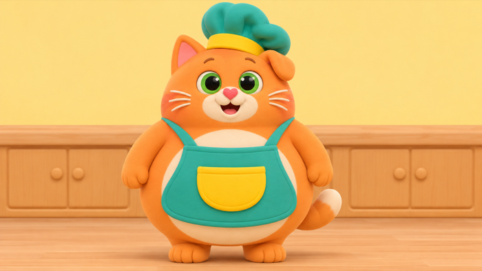
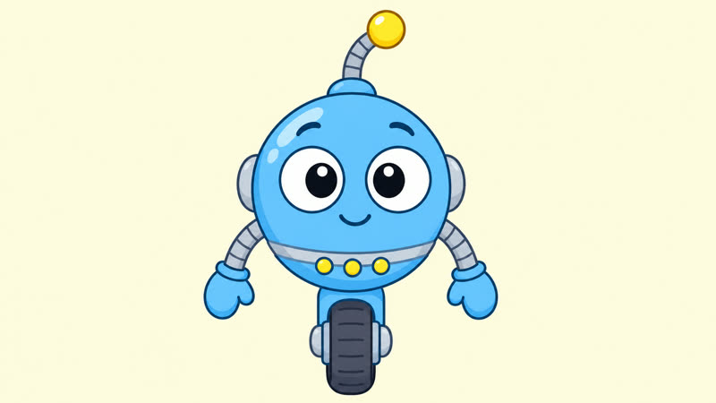

# Cartoon pipeline

Makes short cartoons starring **any character**: a round orange cat who cooks, a blue robot who
counts, whatever is described. The character speaks every line, stays the same in every scene, and
does one small thing per scene.

Nothing here is specific to one character. A character is a **show**: a folder with one settings
file and one picture. Two shows are included: `shows/mango/` (three finished episodes) and
`shows/pip/` (made from one sentence, to prove a new character needs no code).

 

## How a new character gets its rules

A video model left alone gives a cat a third arm, a robot a second wheel, puts a second copy of the
character in the room, moves a mark to the other side, and writes nonsense letters on the wall. What
stops it is telling it exactly what the character is, in every picture and every clip. For a new
character those rules are written by a model, not by hand:

1. **Describe the character**, and give a picture of it if you have one. With no picture, Codex
   draws a character sheet from the description.
2. **A model looks at that sheet** and reads the description. Where they disagree about looks, the
   picture wins.
3. **It writes `show.json`**: the exact look (every colour, every mark and which side it is on,
   what it wears, and what is absent), the art style, the one place every scene happens in, what
   must stay the same from picture to picture, and two sets of keep-in-line rules:
   - `picture_rules` for still pictures: how many of each body part this character has, that the
     hand doing the action is in view, what must never appear;
   - `clip_rules` for moving clips: what the character keeps from the first frame, the counts
     again, the place and the light.
4. **You read it and correct it.** These rules go into everything, so a wrong one is wrong everywhere.

What it wrote for Pip, from *"a small round sky-blue robot with one bendy antenna with a yellow
ball on top, two big round white eyes, short arms with mitten hands, and one wheel instead of legs"*
and the sheet Codex drew:

> **picture_rules**: Exactly one robot: one body, one antenna with one yellow ball, two eyes, two
> arms, two mitten hands, one wheel. Every counted object and the mitten hand doing the action are
> fully visible and not hidden by anything. No second Pip, no fingers, no fire, no smoke, no text.
>
> **clip_rules**: Exactly one robot. Pip keeps exactly the sky-blue ball body, the bent grey antenna
> with its yellow ball, the grey belt with three yellow buttons and the sky-blue mitten hands of
> the first frame. Two arms, two mitten hands, one wheel, no legs, no tail, no extra limbs. The same
> playroom in bright daytime with the same soft even light in every frame; no fire, no smoke, no text.

The three yellow buttons and the belt were never mentioned in the description. The model saw them
on the sheet and wrote them into the rules, with the note: *"the belt always carries exactly three
yellow buttons, and [this] tends to drift or multiply between scenes."*

## Use it from a chat (MCP)

`mcp_server.py` lets any assistant that speaks MCP run this pipeline on its own. The same tools, prefixed `cartoon_`, are also in the repository's one server for every pipeline, [`pipelines_mcp.py`](../pipelines_mcp.py), and what to ask first is written down in [`skills/cartoon/SKILL.md`](../skills/cartoon/SKILL.md). It tells the assistant to
**start by asking what character you want**, before it calls anything.

```json
{"mcpServers": {"cartoon": {"command": "uv", "args": ["run", "/path/to/n8n-video-pipelines/cartoon/mcp_server.py"]}}}
```

What the assistant is told to do, in order:

1. Ask: what is the character (describe it), its name, is there a picture of it, what kind of
   cartoon and where, who is it for.
2. `create_show`: draw or take the character sheet and write the rules (two to four minutes).
3. Show you the sheet and read you the rules. Fix anything with `update_show`.
4. Ask what the episode is about, `write_episode`, read the lines back, change scenes with `save_episode`.
5. `run_step` four times: `pictures`, `voice`, `shoot`, `finish`.
6. Hand you `final.mp4` and the vertical `short.mp4`.

| Tool | What it does |
|---|---|
| `list_shows` | every show and its episodes |
| `create_show` | new character: sheet, look, style, place, rules, voice |
| `get_show`, `update_show` | read a show; correct one rule, the look, or the voice |
| `write_episode` | a model writes the scenes from one sentence |
| `get_episode`, `save_episode` | read a script and what has been made; replace the script |
| `run_step` | `pictures`, `voice`, `shoot` or `finish`, in the background |
| `job_status` | is a step still running, and its result |

Slow steps run in the background, so a tool call returns at once and the assistant checks back.

## Use it from the command line

```bash
# 1. a new character (add --picture /path/to/your.png to use your own drawing)
uv run new_show.py pip --name "Pip" --describe "a small round sky-blue robot with one bendy antenna ..." --what "children's counting cartoon"
#    read shows/pip/show.json and shows/pip/character_sheet.png, correct any rule by hand

# 2. an episode
python3 write_episode.py pip/five_apples "Pip counts five red apples into a basket, one at a time" --scenes 4
#    read shows/pip/five_apples/script.json

# 3. film it
python3 cartoon_job.py pictures pip/five_apples    # a start picture per scene, drawn from the character sheet
python3 cartoon_job.py voice    pip/five_apples    # the character's voice, one line per scene
python3 cartoon_job.py shoot    pip/five_apples    # one clip per scene on the GPU, up to four tries until the words match
python3 cartoon_job.py finish   pip/five_apples    # final.mp4 and a vertical short.mp4
```

Every step prints one line of JSON and can be run again: it only does what is missing. The n8n
workflow [`workflows/cartoon-machine.json`](../workflows/cartoon-machine.json) chains the four
filming steps; set its `episode` value to `<show>/<episode>`.

Needs: the Codex command-line program (pictures), the `claude` command-line tool signed in (rules
and scripts), a Fish Audio key and a GPU set up as in [`docs/RUNBOOK.md`](../docs/RUNBOOK.md)
(voice and clips), `ffmpeg`, `uv`.

## What is in a show

```
shows/pip/
  show.json              the settings below
  character_sheet.png    the one picture every start picture descends from
  five_apples/
    script.json          one entry per scene: says, picture, does
```

| `show.json` | |
|---|---|
| `name` | the character's name, as spoken |
| `what` | the kind of cartoon ("children's counting cartoon") |
| `character` | the exact look, one paragraph |
| `style` | the art style, one sentence |
| `place`, `place_word` | where every scene happens, and one word for it |
| `keep_same` | what must be identical from picture to picture |
| `picture_rules` | keep-in-line rules for still pictures |
| `clip_rules` | keep-in-line rules for moving clips |
| `voice` | Fish Audio voice id, speed, and three words for the tone |

A scene in `script.json`:

```json
{"n": 2,
 "says": "In goes one. In goes two.",
 "picture": "the start of the scene as a still picture, in full: where the character is, every object left to right and its state, what is held",
 "does": "the movement, as things seen happening, tied to the words"}
```

## Why it stays consistent

- **The model never invents the character.** Every scene starts from a picture drawn from the same
  character sheet (scene 1 from the sheet, every later scene from scene 1).
- **Everything a scene uses is already in its start picture.** Things that have to appear mid-scene
  come out wrong.
- **The voice comes first.** The line is recorded, then the clip is filmed around it, so the mouth
  follows the voice and the voice is the same every time.
- **One small action per scene**, camera locked, no cuts.
- **Actions are written as things seen happening** ("the apple is seen travelling from the rug to
  the basket"), not as intentions.
- **The show's rules are in every prompt.**
- **Every clip is checked**: it is transcribed and compared with the line; below 0.97 it is filmed
  again, up to four tries.

## Limits

- One character per show. Two characters talking to each other has not been tried.
- The character speaks its own lines. There is no narrator-only mode.
- One fixed place per show.
- Mango's three episodes were filmed. Pip's rules, script and start pictures were made with the new
  steps; Pip has not been filmed yet.
- `REPORT.md` is the history of how the method was found, written when only Mango existed.
