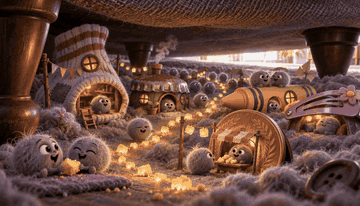
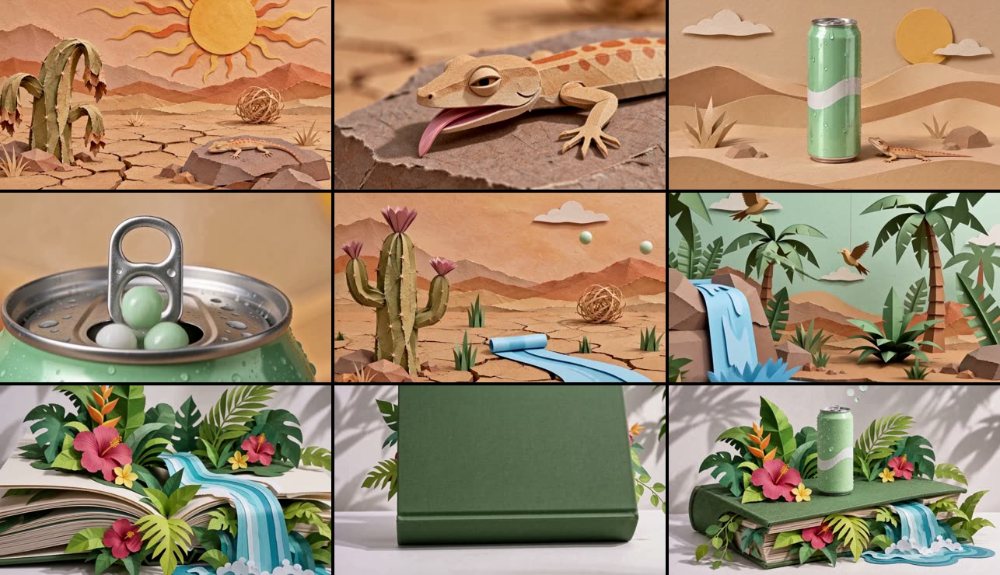
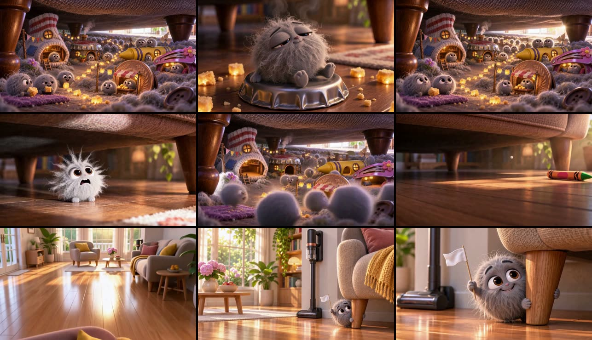
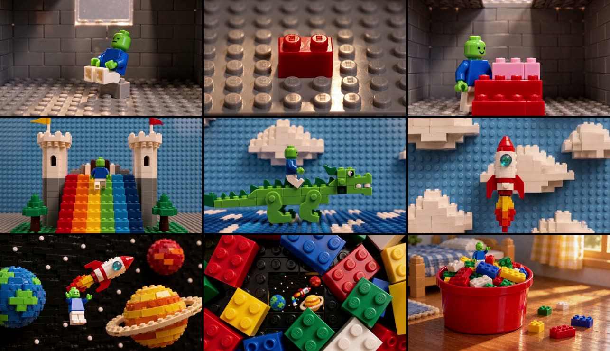
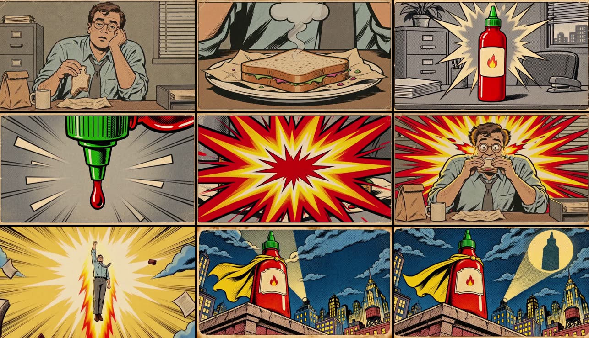
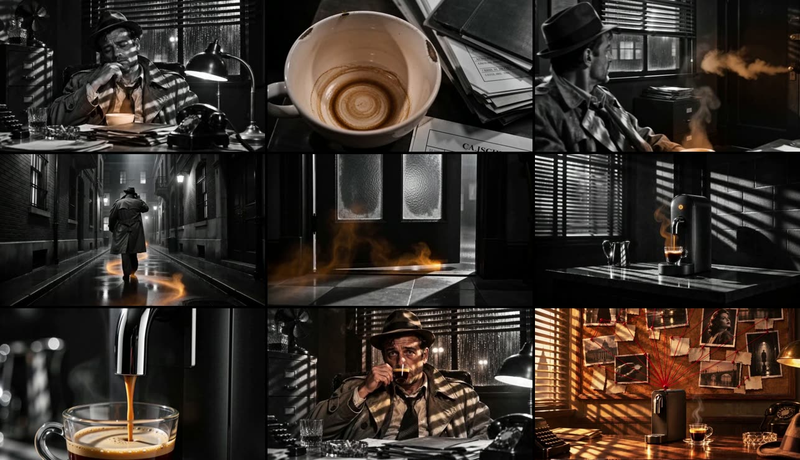
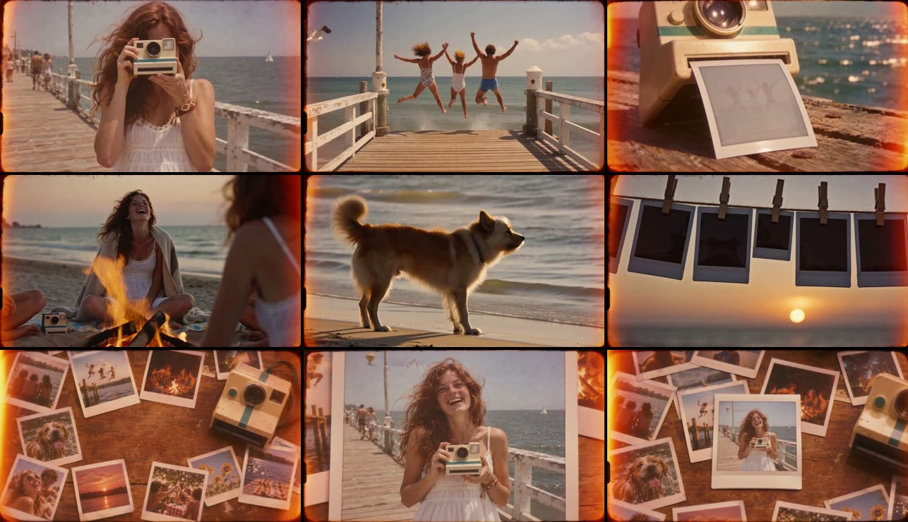
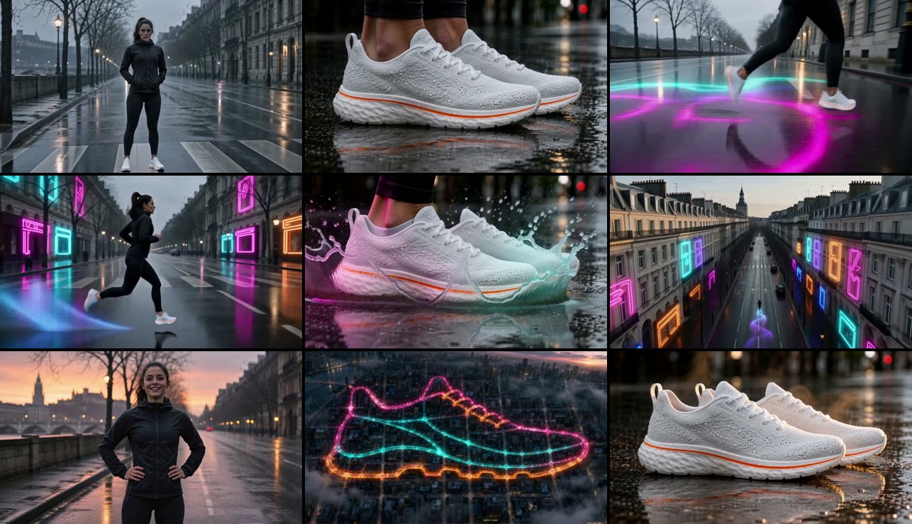
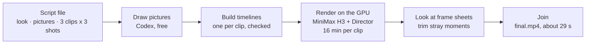

# Cinematic commercial pipeline

Makes a 30-second commercial for one product: nine shots, one art style from start to
finish, a short story that makes sense, and the product shown in a clever way at the end.

<p>
  
  
</p>

## What it is for

- **Concept commercials.** Show a client, or yourself, what an ad for a product could look
  like before anyone books a studio. One idea costs about 60 cents of GPU time.
- **Trying looks.** The same product can be shot as live action, stop motion, a comic, an
  oil painting, a pixel game. Each look is one line in the script file.
- **Product videos with direction.** Where the other pipelines here film one talking shot
  at a time, this one films several shots in a single clip, with cuts and camera moves, so
  the light, the look and the product stay the same across the cut.

It is not for long videos, for people talking to camera at length (use the educational
pipeline or the talking avatar), or for anything that needs readable text on screen.

All examples here use made-up, unbranded products. A real brand's name, logo or product
shape needs that brand's permission.

## Examples

Each one is about 29 seconds, 1024 px wide here (rendered at 1344x768), with sound effects
and one spoken line. Nine frames from each, one per shot:

| | Product | Art style | How the product is shown at the end |
|---|---|---|---|
| 1 | Sparkling water can | Handmade paper craft | The paper jungle folds shut into a pop-up book; the real can stands on top. "Open something." |
| 2 | Cordless vacuum | 3D animated family film | A dust bunny peeks out from behind the sofa leg waving a white flag. "Nowhere left to hide." |
| 3 | Building bricks | Stop motion made of bricks | The whole brick universe turns out to be inside the tub on the bedroom floor. "Everything is in there." |
| 4 | Hot sauce | Vintage comic book | The bottle stands on a rooftop in a cape, its shape projected on the clouds. "Every lunch needs a hero." |
| 5 | Espresso machine | 1940s black-and-white detective film, only the coffee in colour | An evidence board where every red string leads to the machine. "Case closed." |
| 6 | Instant camera | 1970s Super 8 home movie | The last moving shot gets a white border and becomes a photo beside the camera. "Keep it." |
| 7 | Running shoes | Live action, grey city turning neon | Seen from above, the streets she lit up trace the outline of the shoe. "Run it awake." |

**1. Sparkling water can, paper craft** · [video](../examples/cinematic-commercial/sparkling_water_paper_craft.mp4) · [script](ads/paper-fizz/spec.json)



**2. Cordless vacuum, 3D animated film** · [video](../examples/cinematic-commercial/cordless_vacuum_3d_animation.mp4) · [script](ads/dust-bunnies/spec.json)



**3. Building bricks, stop motion** · [video](../examples/cinematic-commercial/building_bricks_stop_motion.mp4) · [script](ads/brick-world/spec.json)



**4. Hot sauce, comic book** · [video](../examples/cinematic-commercial/hot_sauce_comic_book.mp4) · [script](ads/hero-sauce/spec.json)



**5. Espresso machine, film noir** · [video](../examples/cinematic-commercial/espresso_machine_film_noir.mp4) · [script](ads/noir-coffee/spec.json)



**6. Instant camera, 1970s home movie** · [video](../examples/cinematic-commercial/instant_camera_home_movie.mp4) · [script](ads/instant-camera/spec.json)



**7. Running shoes, live-action neon city** · [video](../examples/cinematic-commercial/running_shoes_neon_city.mp4) · [script](ads/sneaker-city/spec.json)



Seven more are written and drawn but not rendered yet. Their scripts are in `ads/` and
work the same way: mechanical keyboard as a 16-bit pixel game (`pixel-keys`), electric car
as a Japanese ink painting (`ink-car`), chocolate bar as a Dutch oil painting
(`baroque-chocolate`), suitcase as a 1930s travel poster (`poster-suitcase`), laundry
detergent in felted wool (`felt-sheep`), wireless speaker in 1980s neon (`synth-speaker`),
bedside lamp as a shadow-puppet theatre (`shadow-lamp`). Each folder has `pictures.jpg`,
the pictures Codex drew for it.

## How it works



1. **Script** (`ads/<name>/spec.json`). One file holds the whole commercial: the look in one
   sentence, the two or three pictures to draw (the person or character, the product, the
   clever end picture), and three clips of three shots each. A shot is a length in frames,
   a camera move, a sentence of what happens, optionally the picture it uses and a
   voiceover line.
2. **Pictures** (`adkit.py draw`). Codex image generation draws each picture once. The
   video model copies them, so the character and the product look the same in every shot.
3. **Timelines** (`adkit.py build`). Each clip becomes one timeline for the
   [MiniMax Director](https://github.com/imbutus/ComfyUI-MiniMaxDirector), which writes the
   prompt in the exact layout the video model was trained on: which picture is which, shot
   by shot with cut times, camera moves in the model's own words, the voiceover line, the
   sounds. The timeline is checked before any GPU time is spent.
4. **Render** (`box/run_director.py` on the GPU). MiniMax H3 films each 10-second clip,
   three shots with cuts, picture and sound together.
5. **Check** (`adkit.py sheet`). Twelve frames per clip on one sheet. Look for a character
   that changed, an object that appears too early, a stray first or last moment.
6. **Join** (`adkit.py join`). Half-second fades between clips, fade out at the end.

There is no n8n workflow for this pipeline yet. The steps are run by hand or by an agent,
because step 5 still needs eyes.

## Exactly what runs

| | |
|---|---|
| Video model | MiniMax H3 reference-to-video: `minimax_h3_ref2va_pruned_int8_convrot.safetensors` |
| Text encoder | `qwen3vl_32b_minimax_h3_nvfp4_awq.safetensors` |
| Video and audio decoders | `minimax_h3_video_vae_int8_convrot.safetensors`, `minimax_h3_audio_vae_fp32.safetensors` |
| Prompt writer | ComfyUI-MiniMaxDirector, node `MiniMaxDirector`, commit `dc38ef9`, reference pictures at `max` size |
| Sampling | 20 steps, `res_multistep`, `simple` schedule, no speed-up LoRA |
| Clip | 243 frames at 24 fps (10.1 s), 1344x768, three shots |
| GPU | One RTX 5090, 32 GB. The swap machine already has every file above. |
| Time and cost | About 16 minutes per clip, 50 minutes per commercial, about $0.60 at $0.74 per hour |
| Pictures | Codex image generation, 16:9, sized to 1344x768 |

A clip's length has to be 124, 141, 158 ... 243 frames (`length % 17 == 5`); `adkit.py`
refuses anything else.

## Run it

Once:

```bash
# on the Mac, in this folder
git clone https://github.com/imbutus/ComfyUI-MiniMaxDirector vendor/ComfyUI-MiniMaxDirector

# on the GPU, in ComfyUI/custom_nodes, then restart ComfyUI
git clone https://github.com/imbutus/ComfyUI-MiniMaxDirector && cd ComfyUI-MiniMaxDirector && git checkout dc38ef9
```

For each commercial:

```bash
python3 adkit.py draw  ads/paper-fizz/spec.json    # Codex draws the pictures; look at ads/paper-fizz/pictures.jpg
python3 adkit.py build ads/paper-fizz/spec.json    # writes paper_1.json, paper_2.json, paper_3.json and checks them

# copy the .png pictures to ComfyUI/input and the three .json files plus box/run_director.py to the GPU, then there:
python3 run_director.py 11 paper_1.json paper_2.json paper_3.json      # 11 is the seed
# FRONT=1 python3 run_director.py 11 paper_3.json                      # redo one clip ahead of the queue
# python3 drop.py paper_2                                              # take a waiting clip out of the queue

# bring ComfyUI/output/video/paper_N_00001_.mp4 back into ads/paper-fizz/clips/paper_N.mp4 (collect.sh does this from ~/Downloads)
python3 adkit.py sheet ads/paper-fizz              # frame sheets to look at
python3 adkit.py join  ads/paper-fizz              # ads/paper-fizz/final.mp4
```

`adkit.py` needs `ffmpeg` and the Codex command-line program (set `CODEX_BIN` if it is not
in the ChatGPT app).

## The script file

```json
{
 "name": "paper",
 "style": "A handmade paper-craft diorama filmed for real: everything cut and folded from coloured paper ...",
 "picture_style": "Style: a photograph of a handmade layered paper-craft diorama ...",
 "voice": "A woman with a bright, playful, refreshing voice",
 "pictures": {
  "can":  {"draw": "what Codex should draw", "is": "what the prompt calls it"},
  "book": {"draw": "...", "is": "..."}
 },
 "clips": [
  {"sound": "what is heard, no music",
   "shots": [
    {"len": 85, "pic": "desert", "camera": "truck_right", "amp": "small", "speed": "slow", "text": "{desert}, paper heat rays quivering ..."},
    {"len": 75, "camera": "static", "text": "a close-up of the small flat paper lizard ..."},
    {"len": 83, "pic": "can", "camera": "dolly_in", "amp": "small", "speed": "slow", "text": "{can} standing upright ...", "say": "optional voiceover line"}
   ]}
 ]
}
```

- `{can}` in a shot's text becomes that picture's token in the prompt. A picture has to be
  the `pic` of some shot in the same clip before it can be named there.
- `camera` is one of the director's moves: `static`, `dolly_in`, `dolly_out`, `zoom_in`,
  `zoom_out`, `pan_left`, `pan_right`, `truck_left`, `truck_right`, `tilt_up`, `tilt_down`,
  `pedestal_up`, `pedestal_down`, `orbit`, `tracking`, `handheld`. `amp` is `small` or
  `large`, `speed` is `slow` or `fast`.
- A picture can carry its own `"style"` when it must not be drawn in the ad's look (a plain
  product photo inside a neon ad).

## Rules that came from real failures

Each of these cost at least one render.

- **Do not film a small object being picked up or handled.** It warps and changes
  direction. Show it lying still, then cut to it already in place.
- **Draw the product once and use that picture in every shot it appears in,** the end
  shot included. Otherwise its shape changes between shots.
- **Give a character's picture to every clip the character is in.** A clip without it
  invents a new character.
- **Name the picture in every shot that shows it** (`{shoe}`), not only the first.
- **Draw people and products on plain backgrounds.** The model drags a picture's
  background into the shot: "rooftop" came out as the street behind the runner.
- **A clip that opens or closes on a character can snap to the pose in its picture for a
  moment.** Look at the first and last half second and trim it.
- **"Presenter" makes the model draw a human host.** Name the character instead.
- **Say what must not be there:** "no wire", "lips closed", "nobody speaks", "nothing is
  picked up".
- **No lettering in the video.** The model garbles it. Add titles afterwards (the swap
  pipeline's caption step does this with raea).
- **Voiceover lines of two to five words come out word for word.** Longer lines and
  on-camera speech are less reliable in drawn styles.
- **Ask for sounds, not music.** Music differs from clip to clip and the joins are heard.
  Put one music track over the finished video instead.
- **Check frame sheets for story slips:** a full cup on the desk before the detective has
  found the coffee.

## Known weak spots

- Background details change between shots (a sun's shape, a hair clip that comes and goes).
- Fine actions are often skipped: the dog stood still instead of shaking off water.
- Pictures inside the picture (photos on a string) can come out blank.
- Nothing here checks the result automatically yet. The educational pipeline's
  `scripts/clip_check.py` could be adapted for that.
