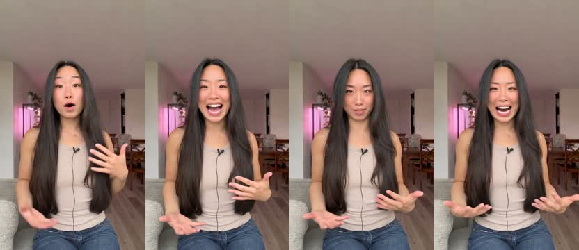

# Talking avatar (LongCat-Video-Avatar 1.5)

One picture of someone + one voice recording goes in. A video of that someone saying those words comes out: lips, face, head and hands move with the voice.

It is kept apart from the three pipelines because it works differently from everything else here. It is a tool that is run by hand for now; no n8n workflow drives it yet.



Example: [`examples/talking/first_test.mp4`](../examples/talking/first_test.mp4) (first test, 3.7 seconds, one segment).

## What it is for

- A real person talking to camera from their own photo and their own (or a cloned) voice.
- Any speaker the picture shows: a person, a cartoon, an animal, a mascot.
- Long takes: clips are built from segments that continue each other, so a minute or more stays one shot.

It is not for shots without a speaker (scenery, product close-ups, action), for big movement such as walking, or for scene changes inside one clip. Those stay with the general models.

## How it differs from the other models in this repository

| | MiniMax H3 / HyperFlow Flash (episodes, cartoon) | OpenJutsu one-click swap (person swap) | LongCat Avatar 1.5 (this folder) |
|---|---|---|---|
| Starts from | Text, plus a start picture | An existing video of someone else | One picture and a voice file |
| What drives the mouth | The model makes picture around the audio; words can still come out wrong, so every take is transcribed and checked | The original performer's movements | The voice file itself; the model is built for lip sync |
| Best at | Any kind of shot: places, actions, cutaways | Re-filming a real clip with our presenter | A person talking, for as long as needed |
| Clip length | Short takes joined in editing | Length of the source clip | Any length, 3.2 s added per segment |
| Runs in | ComfyUI | ComfyUI | Its own program and Python environment, beside ComfyUI |
| Card memory | Fits a 32 GB card | Fits a 32 GB card | Needs the two fixes below to fit 32 GB |

In short: the others decide what the picture shows and hope the mouth matches. This one takes the voice as the fixed thing and makes the face follow it.

## Files

| File | What it does |
|---|---|
| `setup_longcat.sh` | Installs everything on the rented machine: the program, its own Python 3.10, the packages, about 70 GB of model files. Run once. |
| `fit_32gb.py` | Two small edits to the program so it fits a 32 GB card (called by the setup script). |
| `flash_attn_shim.py` | Stand-in for a speed package that does not build on the RTX 5090 (used by the setup script only when the real one fails). |
| `run_talk.sh` | Makes one clip: picture, voice file, description, name, number of segments. |
| `example-script.md` | A 45-second spoken script with notes for on-screen pieces. |

## Setup

On a Vast.ai machine with 1x RTX 5090, at least 60 GB of memory and 120 GB of disk (the ComfyUI template is fine; this installs beside it):

```bash
scp -r talking <machine>:/workspace/talking
ssh <machine> 'bash /workspace/talking/setup_longcat.sh'
```

Allow 30 to 45 minutes, most of it downloading.

## Making a clip

```bash
bash /workspace/run_talk.sh <picture> <voice.wav> "<description>" <name> <segments> 480p
```

- **picture**: the speaker, as they should look in the video. A portrait picture gives a 480x832 video.
- **voice.wav**: the full spoken track (Fish Audio in this project).
- **description**: who is in the picture, what they wear, the room, and that they are speaking to the camera. Longer and more concrete works better.
- **segments**: one segment is 3.7 seconds; each further one adds 3.2 seconds. For a voice track of `d` seconds use `ceil((d - 3.72) / 3.2) + 1`.

The result is `/workspace/LongCat-Video/outputs/<name>/ai2v_demo_1.mp4`.

Measured on an RTX 5090 at 480p: about 2.5 minutes per segment, so roughly 40 minutes for one minute of video.

## What had to be fixed to run it on an RTX 5090

These are all handled by `setup_longcat.sh`; they are listed so the next person does not rediscover them.

1. **Python version.** The package list is written for Python 3.10 and fails on the machine's 3.12. The script builds a separate 3.10 environment.
2. **Package list.** Two entries (`libsndfile1`, `tritonserverclient`) are not Python packages, and the pinned torch does not know the 5090. They are dropped and a CUDA 12.8 torch is installed.
3. **flash_attn does not build.** `flash_attn_shim.py` supplies the two functions the program calls, using the attention built into torch.
4. **Out of memory at load.** The text encoder (about 11 GB) is kept in main memory; set by `TEXT_ENCODER_ON_CPU=1` in `run_talk.sh`.
5. **Out of memory while sampling.** The Whisper voice encoder and the vocal separator are moved off the card once the voice has been read. After this the card holds about 16 GB before sampling starts.
6. **Launch.** The demo program must be started with `torchrun`, even on one card.

## Not done yet

- No automatic check of the result (words heard back, face, big mistakes) like the episode pipeline has.
- 720p and the two-speaker mode have not been tried.
- No n8n workflow.
